<div align="center">

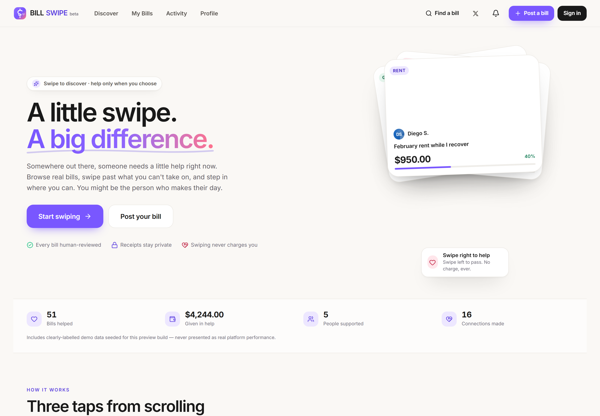

# BILL SWIPE

**Swipe a bill, change a life.**

A swipe-to-help platform for real, verified bills — Tinder-style discovery with a fintech-grade payment pipeline behind it.

[](https://billswipe.852367856.dpdns.org)
[](LICENSE)
[](https://workers.cloudflare.com/)
[](docs/testing.md)
[](https://x.com/0xkillcoin)

[Live demo](https://billswipe.852367856.dpdns.org) · [How it works](https://billswipe.852367856.dpdns.org/how-it-works) · [Trust & safety](https://billswipe.852367856.dpdns.org/trust) · [Follow the build on X](https://x.com/0xkillcoin)

</div>

---

## What this is

Someone out there has a bill they cannot cover this week. BILL SWIPE turns helping them into a swipe instead of a form: one bill at a time, left to pass, right when you want to help, up for "Super Help".

**A swipe never moves money.** It records intent and opens an amount picker. You only pay after confirming an exact, itemised total on a separate screen. That distinction is the entire product thesis, and it is enforced in code — not just in the copy.

> This repository is a working full-stack application, not a UI mock. Accounts, sessions, bill authoring with private receipt storage, human moderation, atomic fund accounting, notifications, reporting, and an audited admin dashboard are all real and exercised by tests.

---

## Screenshots

All screenshots are captured from the live deployment with `npm run shots`.

<table>
  <tr>
    <td width="50%">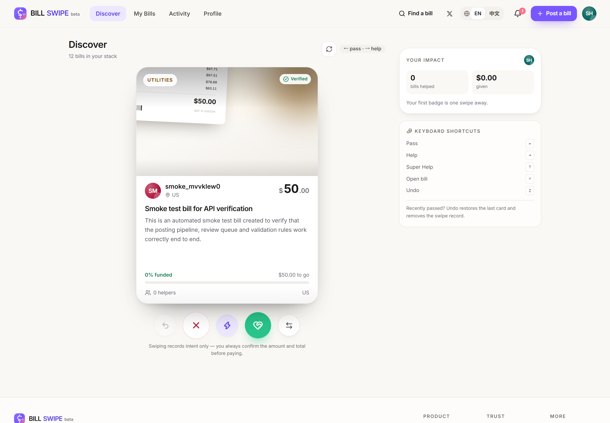<br /><sub><b>Discover</b> — one bill at a time, drag or use the buttons</sub></td>
    <td width="50%">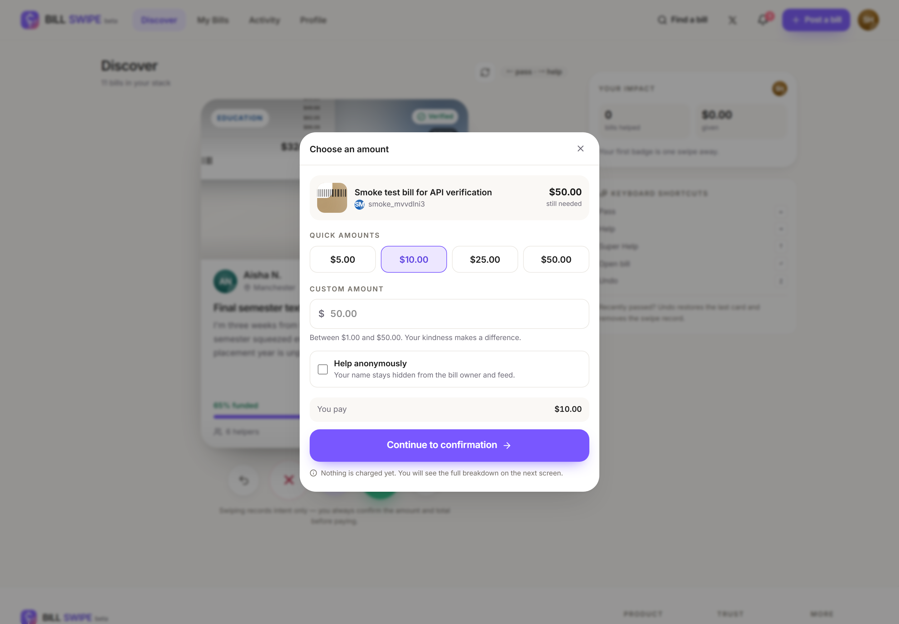<br /><sub><b>Amount picker</b> — quick amounts, custom amount, anonymity</sub></td>
  </tr>
  <tr>
    <td width="50%">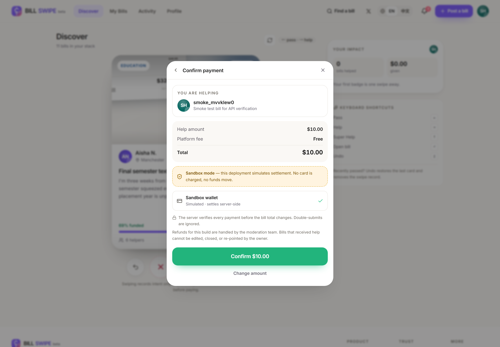<br /><sub><b>Confirmation</b> — itemised total and a loud sandbox notice</sub></td>
    <td width="50%">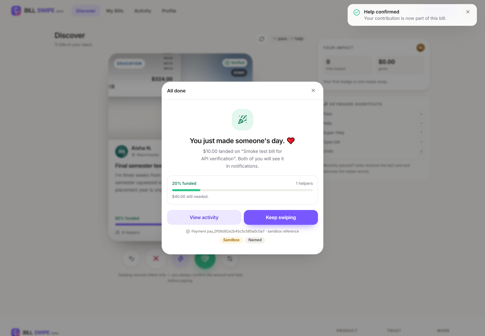<br /><sub><b>Success</b> — server-confirmed, progress updated</sub></td>
  </tr>
  <tr>
    <td width="50%">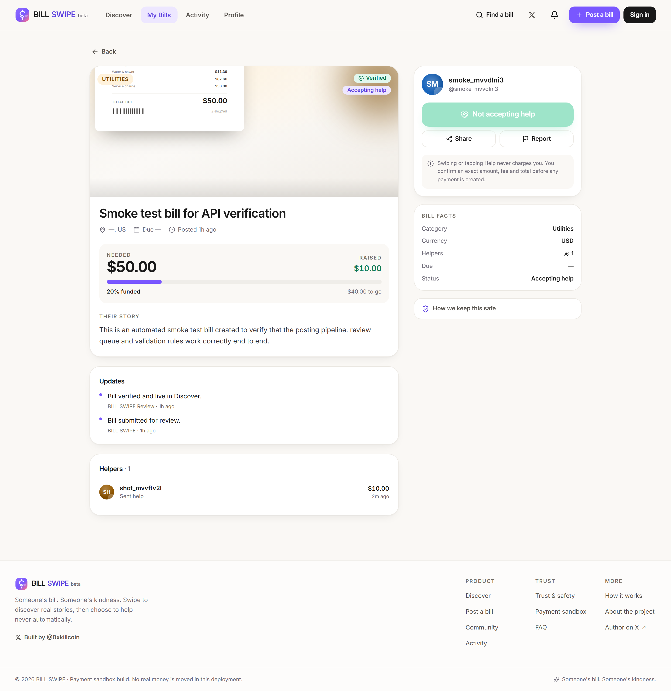<br /><sub><b>Bill detail</b> — story, receipt status, helper list</sub></td>
    <td width="50%">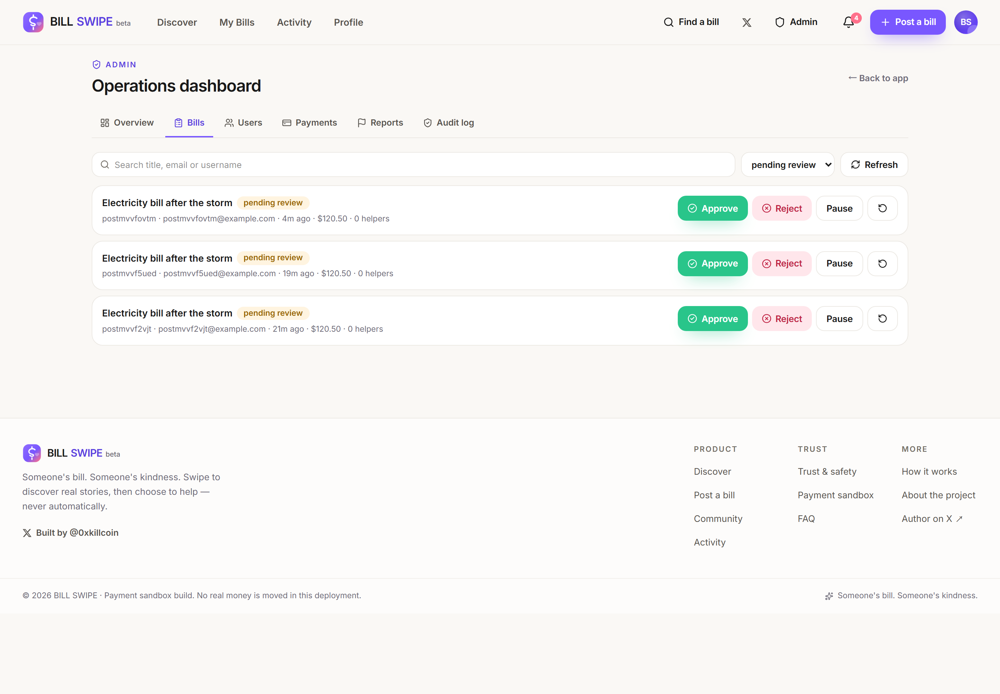<br /><sub><b>Admin</b> — review queue with risk flags and audit trail</sub></td>
  </tr>
</table>

<table>
  <tr>
    <td width="25%">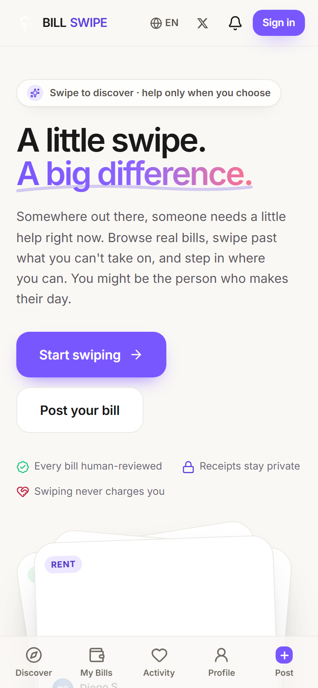<br /><sub>Landing</sub></td>
    <td width="25%">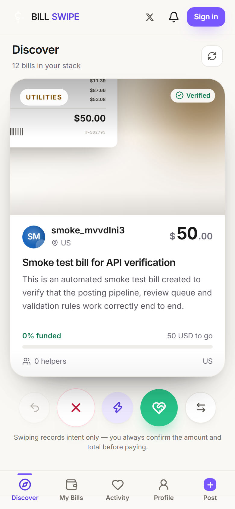<br /><sub>Discover</sub></td>
    <td width="25%">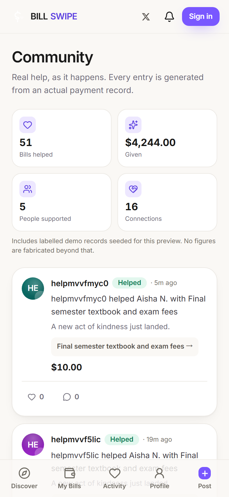<br /><sub>Community</sub></td>
    <td width="25%">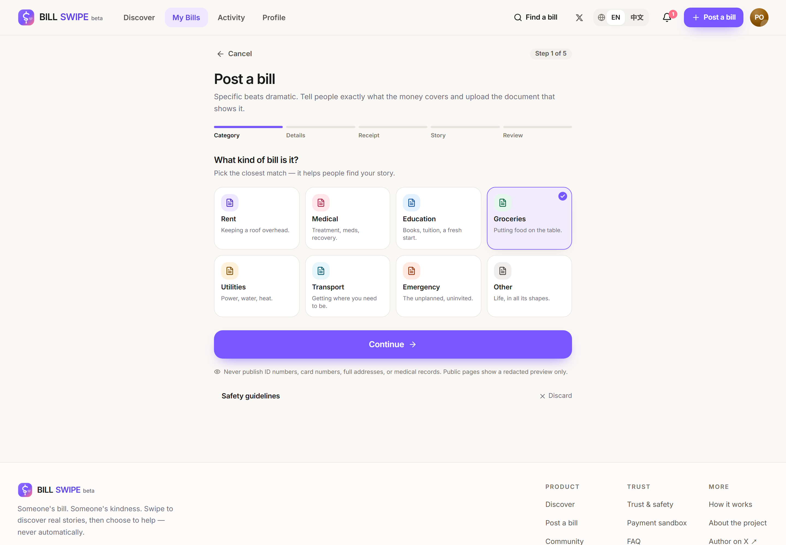<br /><sub>Post a bill</sub></td>
  </tr>
</table>

---

## Features

### Discovering and helping
- **Swipe deck** with pointer dragging, spring physics, rotation, `HELP` / `PASS` / `SUPER HELP` stamps, haptic feedback, and a three-deep card stack.
- **Undo** the last swipe (restores the card *and* deletes the swipe record).
- **Keyboard play**: `←` pass, `→` help, `↑` super help, `↵` open, `Z` undo.
- **Amount picker** with quick amounts ($5 / $10 / $25 / $50), custom amount capped at the outstanding balance, and one-tap anonymity.
- **Two-step confirmation**: server creates a `pending` intent, then a second explicit action settles it. The UI never declares success on its own.

### Posting a bill
- Five-step wizard: category → details → receipt → story → review.
- **Private receipt storage** in R2; the original is served only to authenticated moderators. Files are validated by magic bytes and SHA-256 fingerprinted for duplicate detection.
- Automated pre-moderation signals: duplicate receipt, amount thresholds, posting frequency, PII-looking text, off-platform contact attempts.
- **Locking**: once a bill receives its first payment, the amount and recipient can no longer be edited and the bill cannot be closed by its owner.

### Tracking
- **My Bills** with status filters (in review, live, funded, needs changes, closed) and progress bars.
- **Activity** — help given (with payment status) and help received (respecting anonymity).
- **Profile** with stats, achievements that are deliberately *not* spending-ranked, privacy toggles, notification preferences, password rotation, and blocked users.
- **Notifications** for payment confirmations, bill approvals/rejections, incoming help and full funding.

### Community
- A live feed generated from actual help records (never fabricated testimonials).
- Reactions and moderated comments, rate-limited server-side.
- Impact statistics computed from the database, with demo data explicitly flagged.

### Admin
- Dashboard: users, bills, review queue, live bills, funded bills, succeeded volume, open reports, payment anomalies.
- Bill review: approve / reject with a note / suspend / reopen, plus risk flags and a link to the private receipt.
- User management: search, restrict, ban, restore.
- Payments: full history with refund capability (refund reverses the bill total in the same transaction).
- Reports queue with resolutions, and an **append-only audit log** of every moderation action.

---

## Architecture

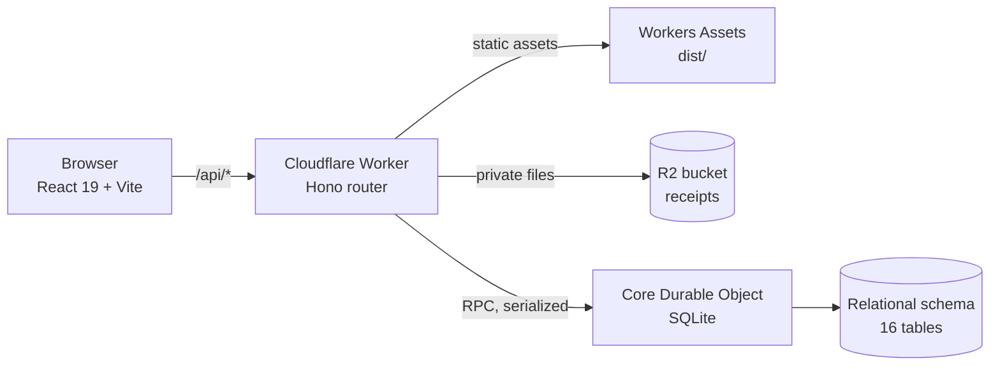

**Why Durable Objects instead of D1?** The free Cloudflare plan caps D1 at 10 databases and this account had already reached the cap with other live projects. A SQLite-backed Durable Object provides the same SQL semantics, gives us a single-writer for atomic fund accounting, and stays inside the free tier. The data layer is isolated behind a small `Db` interface, so swapping to D1/Postgres later is a contained change.

### Stack

| Layer | Choice | Why |
| --- | --- | --- |
| UI | React 19, TypeScript, Tailwind CSS 4 | Fast iteration, no runtime CSS overhead, tokens live in `@theme` |
| Motion | Framer Motion | Drag gestures, spring physics, layout animations |
| Client build | Vite 7 | Instant HMR, tiny output, no framework runtime to pay for |
| API | Hono on Cloudflare Workers | Web-standard `Request`/`Response`, first-class Workers support |
| Data | SQLite in a Durable Object | Relational schema, transactions, single-writer atomicity |
| Files | Cloudflare R2 | Private object storage with per-object metadata |
| Auth | Self-hosted sessions | PBKDF2-SHA256 password hashes, HTTP-only cookie tokens, no third party in the critical path |

### Data model

16 tables: `users`, `sessions`, `bills`, `receipts`, `swipes`, `payments`, `help_records`, `payment_events`, `notifications`, `reports`, `blocked_users`, `audit_logs`, `community_posts`, `community_likes`, `community_comments`, `bill_updates`, plus `rate_limits`, `email_outbox` and a `meta` key/value store.

**Money is always `INTEGER` minor units** (cents). There is no float anywhere in the money path — not in storage, not in transport, not in arithmetic. `formatMoney`/`parseMoneyInput` in `src/shared/money.ts` own the conversion boundary.

Full schema: [`src/worker/db/schema.ts`](src/worker/db/schema.ts).

### Payment state machine

```
                 createPaymentIntent
   (none) ─────────────────────────────▶ pending
                                            │
                        settlePayment ◀─────┼──────▶ failed (failPayment)
                     (sandbox / webhook)    │
                                            ▼
                                        succeeded ──▶ refunded (admin)
                                            │
                                   bill.raised_amount += amount   (same transaction)
                                   help_record + notification + feed post
                                   bill_status → fully_funded when target reached
```

Guarantees that are enforced server-side and covered by tests:

- **Idempotency** — `UNIQUE(payer_id, client_idempotency_key)`; repeating a request returns the original payment.
- **Single settlement** — replaying `settlePayment` on a succeeded payment is a no-op (`alreadySettled: true`).
- **Atomic totals** — the payment flip, bill increment, help record, notification and feed post happen in one transaction; a bill can never be over-funded (verified by a concurrency test).
- **Cap at outstanding balance** — contributions are clamped to what the bill still needs.
- **Provider isolation** — sandbox settlement is refused for any non-sandbox provider.

---

## Security

| Area | Implementation |
| --- | --- |
| Passwords | PBKDF2-SHA256, 60 000 iterations, 16-byte random salt, constant-time comparison |
| Sessions | 256-bit random token, SHA-256 hashed at rest, ~30-day expiry, HTTP-only + SameSite=Lax + Secure cookie |
| Authorisation | Every admin route re-checks `role === 'admin'` server-side; UI hiding is never relied on |
| Object ownership | Bill edit/close/update routes verify `bill.user_id === session user` in the service layer |
| Receipts | Private R2 keys, magic-byte validation, admin-only originals, `Cache-Control: private, no-store` |
| Rate limiting | Durable, per-user/per-IP fixed windows on register, login, payments, uploads, reports and comments |
| Output safety | React escaping by default, control-character stripping, length clamps, no `dangerouslySetInnerHTML` |
| Headers | `X-Content-Type-Options`, `X-Frame-Options: DENY`, `Referrer-Policy`, `Permissions-Policy` on every response |
| Audit | Every approval, rejection, suspension, ban, refund and report resolution is appended to `audit_logs` |

Found something? Please read [`SECURITY.md`](SECURITY.md) before opening a public issue.

---

## Payments: sandbox today, provider-ready tomorrow

This deployment runs in **Payment Sandbox mode** and says so on the confirmation screen, in the footer, and on `/payments-info`. **No real money moves and no card is charged.**

The sandbox is not a fake success toast: it exercises the same server code path a real provider would.

```
POST /api/payments/intent            → creates a pending payment (idempotent)
POST /api/payments/:id/sandbox/settle → server-side settlement, then the bill is updated
```

To go live, the change is confined to the server:

1. Set `PAYMENT_MODE=stripe`, add `STRIPE_SECRET_KEY` and `STRIPE_WEBHOOK_SECRET`.
2. Implement `POST /api/webhooks/stripe` → verify the signature → call the same `settlePayment(paymentId, { source: 'webhook' })`.
3. Complete provider onboarding/KYC for the payout side.

No frontend change is required. Before doing that, this must be reviewed against the money-transmission rules of your jurisdiction — the app deliberately does **not** custody funds itself.

**No Stripe account?** A self-hosted Binance Pay gateway (for example [BinancePayTool](https://github.com/qianyubtc/BinancePayTool)) fits the same provider seam. [`docs/deployment.md`](docs/deployment.md) spells out exactly what wiring it would take, plus the honest trade-offs. It is **not** implemented in this build.

---

## Run it locally

```bash
git clone https://github.com/iiiiiiiiiiiiiKK/bill-swipe.git
cd bill-swipe
npm install

# Terminal 1 — the API on http://127.0.0.1:8787 (local SQLite + R2 emulation)
cp .env.example .dev.vars      # optional; sane sandbox defaults exist
npm run dev:api

# Terminal 2 — the UI on http://127.0.0.1:5173 (proxies /api to :8787)
npm run dev
```

Open <http://127.0.0.1:5173>. The demo dataset (16 fictional bills, 15 people, help records) is seeded automatically on first boot.

**Demo accounts** (seeded, obviously labelled in the UI):

| Role | Email | Password |
| --- | --- | --- |
| Admin | `admin@billswipe.local` | `BillSwipe!Admin2026` |
| Member | register your own — takes 5 seconds | — |

> Rotate or remove these before any real deployment: `ADMIN_EMAIL` / `ADMIN_PASSWORD` seed the bootstrap admin, and setting `ALLOW_DEMO_SEED=false` disables the whole demo dataset.

> **Note on Windows:** `wrangler dev` can crash with a `workerd` stack overflow on some Windows machines (missing VC++ redistributable). The test suite runs against a deployed worker instead — `E2E_BASE_URL=https://your-deployment npm run test:e2e`.

---

## Test it

```bash
npm run typecheck   # strict TypeScript, zero errors
npm test            # 38 unit/integration tests against real SQLite
npm run test:e2e    # 28 Playwright journeys (desktop Chrome + iPhone 13 / WebKit)
node scripts/smoke.mjs https://your-deployment          # 31 API contract checks
node scripts/audit-ui.mjs https://your-deployment       # 337 responsive/a11y checks
```

What the suite actually proves:

- **Money integrity** — no float drift, fee rounding, caps, idempotency, replay safety, refund reversal, and *no over-funding* under concurrent settlement.
- **Authorisation** — normal users get `403` on admin routes; users cannot edit or close other people's bills; anonymous helpers are hidden from the public but visible to the bill owner.
- **UI honesty** — the sandbox banner appears at the confirmation step; success only renders after the server responds.
- **Responsive quality** — zero horizontal overflow, ≥32 px tap targets, no sub-10 px interface text, and WCAG AA contrast across 320 → 1920 px viewports.
- **Real journeys** — register → swipe → choose amount → confirm → success, plus the five-step posting wizard and the admin review queue.

Results from the recorded run are in [`docs/testing.md`](docs/testing.md).

---

## Deploy your own

Full walkthrough — including the Cloudflare account setup, R2 bucket, custom domain and secret management — is in [`docs/deployment.md`](docs/deployment.md). The short version:

```bash
npm install
npx wrangler login
npx wrangler r2 bucket create billswipe-receipts

# Set your own secrets
npx wrangler secret put SESSION_SECRET
npx wrangler secret put ADMIN_PASSWORD

# Optional: point wrangler.toml at your domain, then
npm run deploy
```

`wrangler.toml` already declares the Worker, assets binding, Durable Object migration, R2 binding and custom domain route. The Durable Object holds the database, so there is **no separate migration step** — the schema is created and versioned on first boot.

---

## Project layout

```
src/
  shared/            domain types, money helpers, categories (imported by both sides)
  worker/
    index.ts         Worker entry: /api/* → Hono, everything else → static assets
    api.ts           HTTP layer: routing, Zod validation, cookies, error mapping
    core/
      index.ts       Core Durable Object: RPC dispatch + serialized business writes
      service.ts     Domain services (accounts, bills, payments, moderation)
      queries.ts     Read models / DTO shaping
    db/              schema + typed query layer
    auth/            PBKDF2 hashing, tokens, ids
    seed/            labelled demo dataset
  components/        design-system primitives, bill cards, payment sheet, admin widgets
  pages/             Landing, Discover, Bill detail, Post wizard, Activity, Profile, Admin…
  lib/               API client, auth context, formatting helpers
tests/               unit + integration (vitest) and e2e journeys (playwright)
scripts/             smoke test, UI audit, screenshot capture
docs/                architecture, deployment, testing, screenshots
```

---

## Known limitations

Written down honestly rather than hidden:

1. **Payments are sandboxed.** A real provider, webhook signature verification and payout onboarding are required before handling money. The UI states this everywhere it matters.
2. **Email delivery is queued, not sent.** Verification and notification emails land in `email_outbox` unless `RESEND_API_KEY` is configured. There is no live email provider in this deployment.
3. **Email verification is not enforced** before posting; accounts are created in a verified-pending state and the flow exists, but the gate is intentionally off for the demo.
4. **Single Durable Object.** All writes serialize through one object. Excellent for correctness, and fine at this scale, but it is a throughput ceiling — shard by region or move to D1/Postgres before real volume.
5. **No KYC/identity checks.** Nothing verifies that the person posting a bill is who they claim to be. Moderation is human review of a document, which catches obvious fakes and nothing more.
6. **Image redaction is manual.** The UI warns and asks uploaders to blur sensitive details; it does not automatically detect or redact PII inside images.
7. **Chinese translation is scaffolded, not shipped.** The `locale` field and copy structure exist; only English is wired through the UI.
8. **Demo data is seeded** and clearly labelled (`is_demo = 1`, "Demo" badges). Impact statistics include it, and say so in the UI.

---

## Roadmap

- [ ] Stripe Connect (or a locally licensed provider) with webhook verification and payout splitting
- [ ] Automatic PII detection/redaction on uploaded receipts
- [ ] Email provider integration (verification, digests)
- [ ] Push notifications and a real PWA install flow
- [ ] Multi-currency with FX-aware totals
- [ ] Shard or migrate the data layer for higher write throughput
- [ ] i18n beyond the English launch locale

---

## Contributing

Issues and pull requests are welcome — see [`CONTRIBUTING.md`](CONTRIBUTING.md). Please read `SECURITY.md` first for anything sensitive, and keep the honesty rule: no fabricated metrics, no fake success states.

## License

[MIT](LICENSE) © BILL SWIPE contributors

---

<div align="center">

**Someone's bill. Someone's kindness.**

Built and maintained by [@0xkillcoin](https://x.com/0xkillcoin) · [𝕏](https://x.com/0xkillcoin)

</div>
