<div align="center">

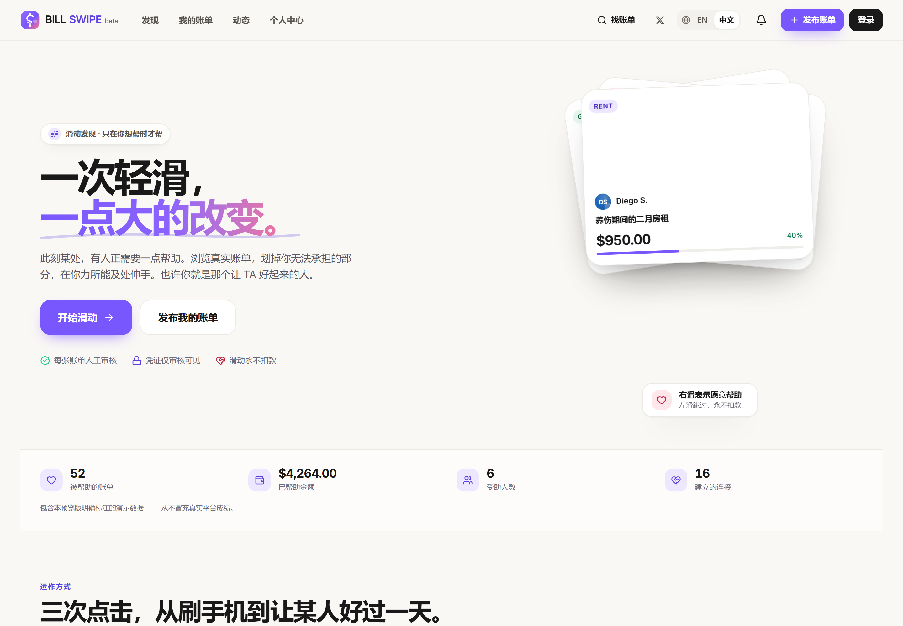

# BILL SWIPE · 账单滑动互助

**刷到一张账单，也许就改变一个人的一天。**

一个基于左右滑动的陌生账单互助平台：发现体验像社交 App，背后的支付流水线按金融系统标准实现。

[](https://billswipe.852367856.dpdns.org)
[](LICENSE)
[](https://workers.cloudflare.com/)
[](docs/testing.md)
[](#languages)
[](https://x.com/0xkillcoin)

**简体中文** · [English](README.md)

[线上体验](https://billswipe.852367856.dpdns.org) · [运作方式](https://billswipe.852367856.dpdns.org/how-it-works) · [信任与安全](https://billswipe.852367856.dpdns.org/trust) · [在 X 上关注开发进展](https://x.com/0xkillcoin)

</div>

---

## 这个产品是什么

此刻有人手里有一张这周付不掉的账单。BILL SWIPE 把「帮一把」变成一次滑动：一次只出现一张账单，左滑跳过，右滑表示愿意帮助，上滑是「超级帮助」。

**滑动永远不会扣款。** 它只记录你的帮助意愿，并打开金额选择；你只有在下一屏确认了逐项明细与总额之后才会真正付款。这条界线写进了代码，而不只是一句宣传文案。

> 这不是静态页面或 UI Demo：账号体系、会话、账单发布与私有凭证存储、人工审核、原子化的筹款记账、通知、举报、屏蔽，以及带审计日志的后台管理，全部真实可用，并有自动化测试覆盖。

---

## 界面截图

以下截图全部来自线上部署（`npm run shots` 自动采集）。

<table>
  <tr>
    <td width="50%">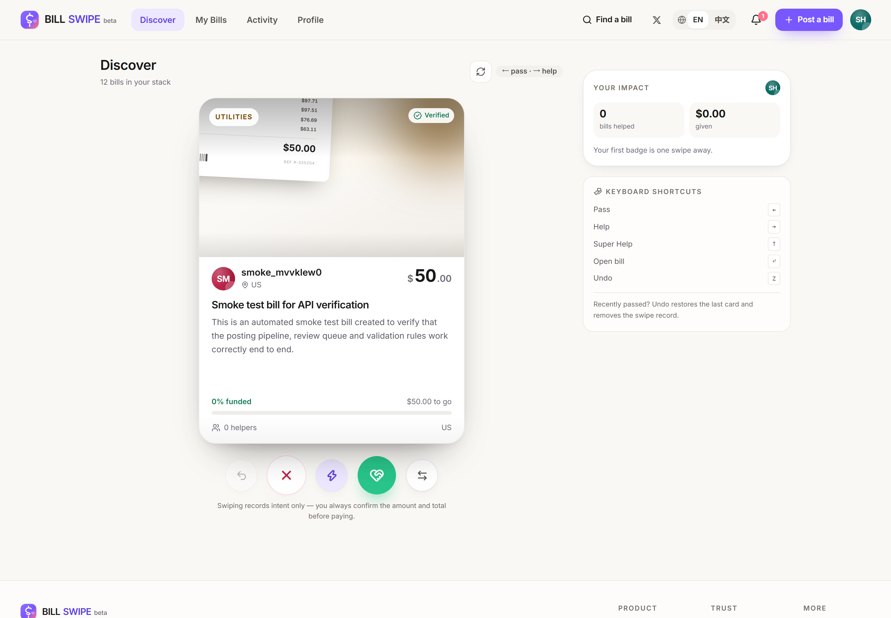<br /><sub><b>发现</b> —— 一次一张账单，可拖拽或点按钮</sub></td>
    <td width="50%">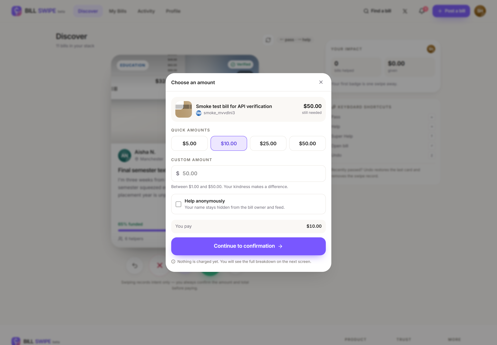<br /><sub><b>金额面板</b> —— 快捷金额、自定义金额、匿名开关</sub></td>
  </tr>
  <tr>
    <td width="50%">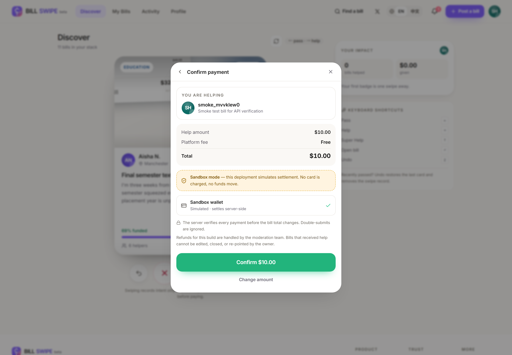<br /><sub><b>确认页</b> —— 逐项总额，并显著标注沙箱</sub></td>
    <td width="50%">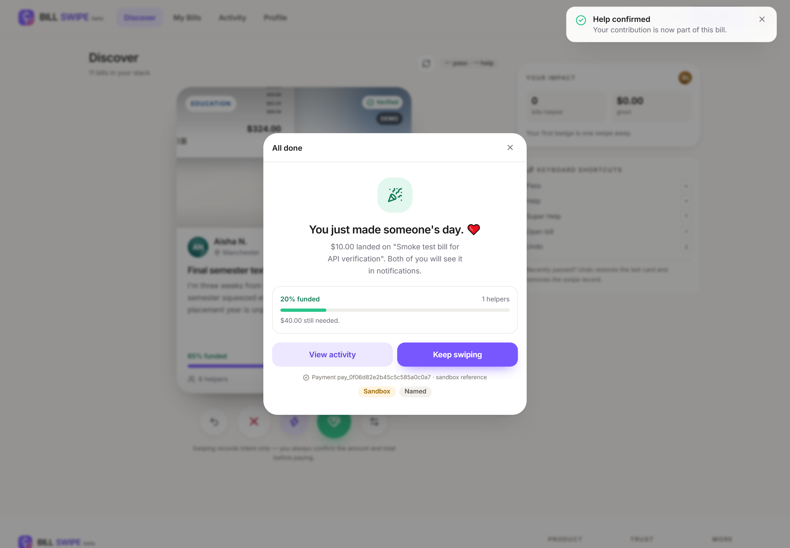<br /><sub><b>成功</b> —— 服务端确认后进度即时更新</sub></td>
  </tr>
  <tr>
    <td width="50%">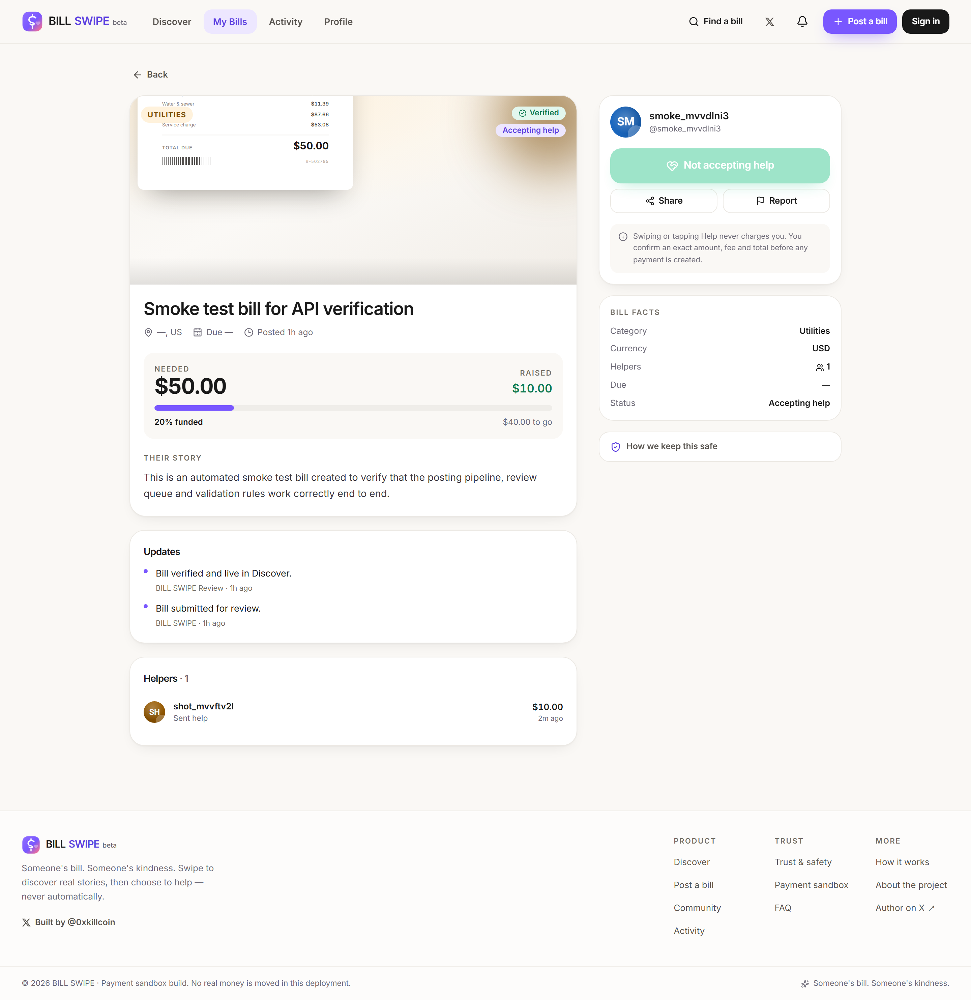<br /><sub><b>账单详情</b> —— 故事全文、凭证状态、帮助者列表</sub></td>
    <td width="50%">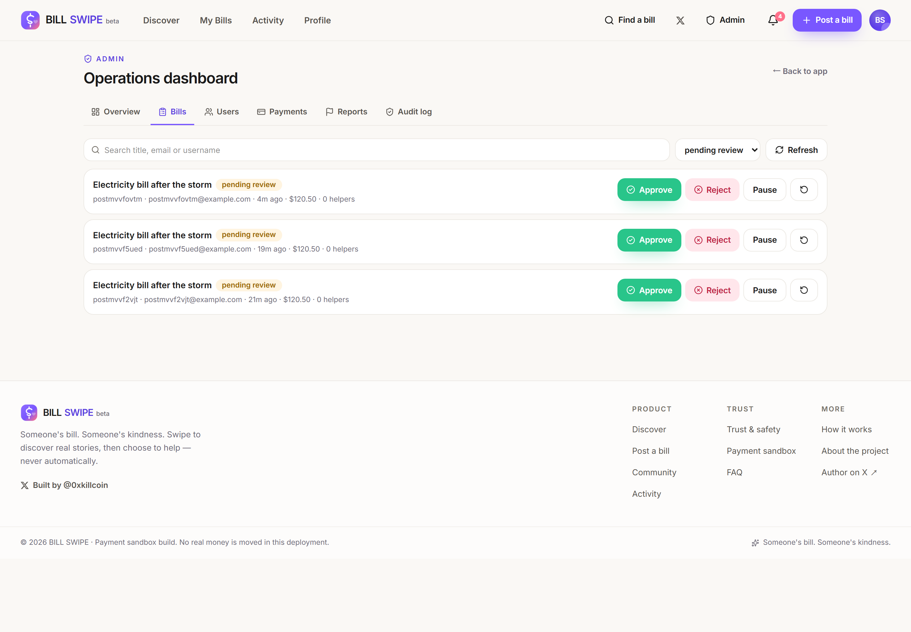<br /><sub><b>后台</b> —— 审核队列、风险标记、审计日志</sub></td>
  </tr>
</table>

<table>
  <tr>
    <td width="50%"><br /><sub><b>中文界面</b> —— 一键切换，全站生效</sub></td>
    <td width="50%">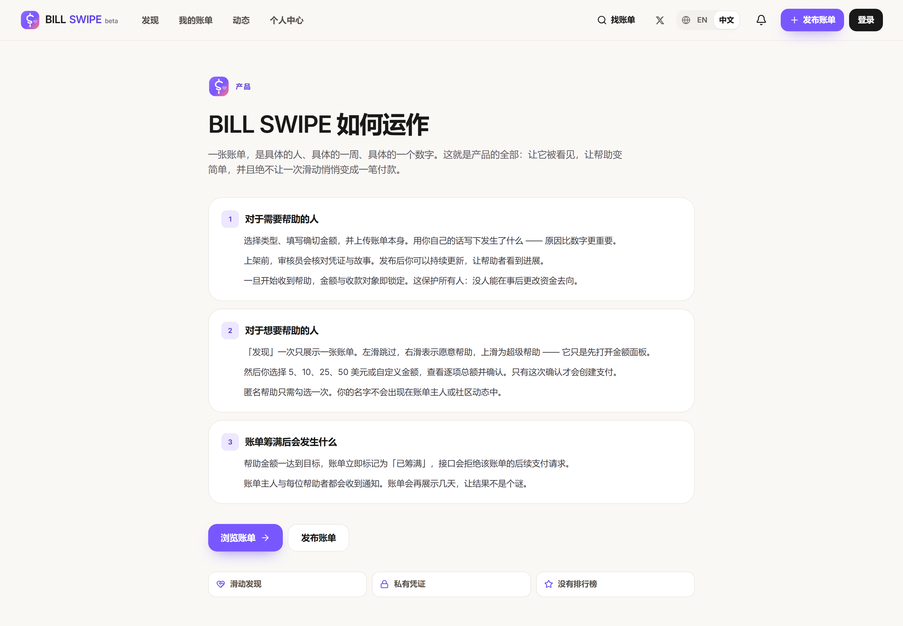<br /><sub>连说明页也是中文，而不只是导航</sub></td>
  </tr>
</table>

<table>
  <tr>
    <td width="25%">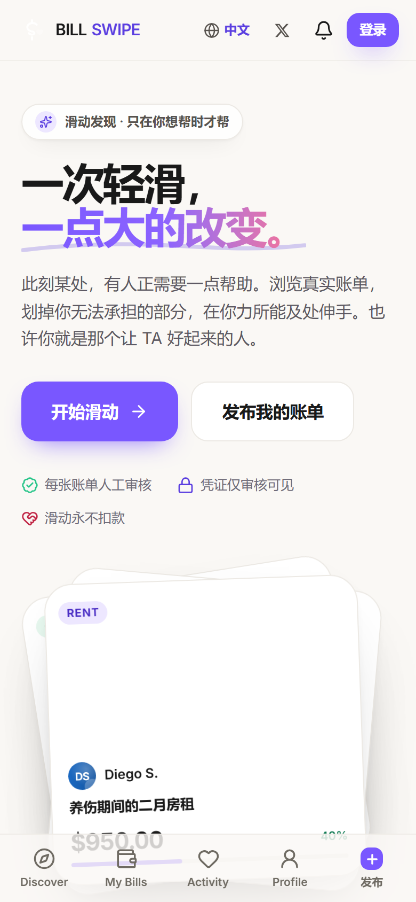<br /><sub>中文移动端</sub></td>
    <td width="25%">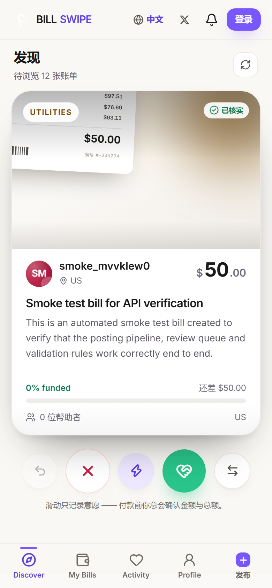<br /><sub>中文滑动页</sub></td>
    <td width="25%">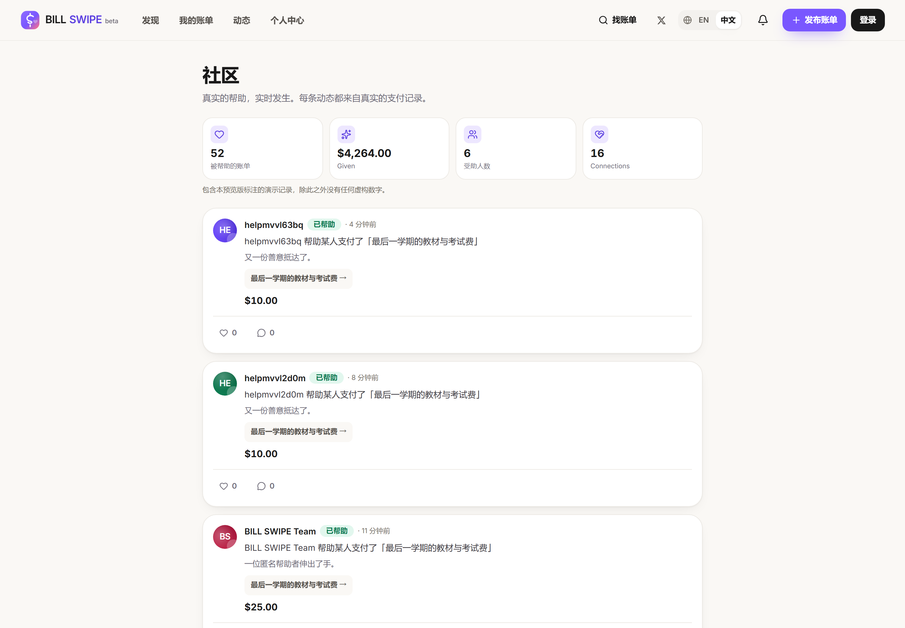<br /><sub>中文社区</sub></td>
    <td width="25%">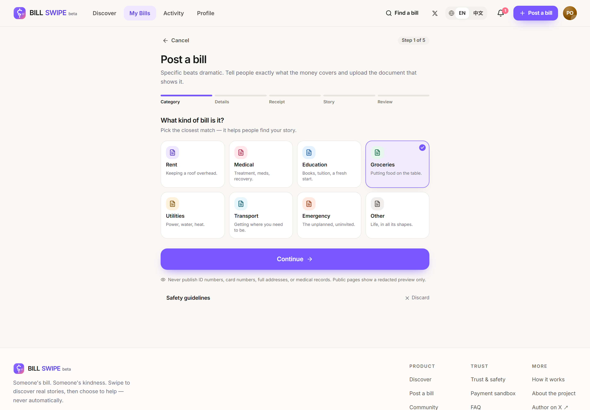<br /><sub>发布账单</sub></td>
  </tr>
</table>

---

## 核心功能

### 发现与帮助
- **滑动卡片**：指针拖拽、弹簧物理、旋转回弹、三层堆叠，并显示 `HELP` / `PASS` / `SUPER HELP` 印章与触觉反馈。
- **撤销** 上一张（既恢复卡片，也删除服务端的滑动记录）。
- **键盘可玩**：`←` 跳过、`→` 帮助、`↑` 超级帮助、`↵` 打开、`Z` 撤销。
- **金额面板**：5 / 10 / 25 / 50 美元快捷金额、自定义金额（上限为剩余所需）、一键匿名。
- **两步确认**：服务端先创建 `pending` 支付意图，再由第二个明确动作完成结算；界面绝不自称支付成功。

### 发布账单
- 五步向导：类型 → 信息 → 凭证 → 故事 → 预览提交。
- **凭证私有存储**（R2）：按文件魔数校验类型，用 SHA-256 指纹做全站重复凭证检测；原件只有审核员能看到。
- 自动预审信号：重复凭证、异常金额、高频发布、疑似证件号/卡号、引导站外联系。
- **锁定规则**：账单收到第一笔帮助后，金额与收款对象不可再改，发布者也不能随意关闭。

### 记录与成长
- **我的账单**：审核中 / 进行中 / 已筹满 / 需修改 / 已关闭，含进度条与帮助人数。
- **动态**：我给出的帮助（含支付状态、退款状态）与收到的帮助（尊重匿名）。
- **个人中心**：统计、成就（刻意不与金额排名挂钩）、隐私与通知开关、改密、屏蔽名单。
- **通知**：支付确认、审核结果、收到帮助、筹款完成。

<a id="languages"></a>

### 多语言（中文 / English）
- 每页顶栏都有语言切换：移动端一枚地球图标，桌面端为 `EN | 中文` 分段控件。
- 选择保存在浏览器，**并同步到账户** `profile.locale`，换设备也会跟随。
- 首次访问按 `navigator.language` 自动判断，中文用户直接进入中文界面。
- 翻译覆盖完整：导航、首页、滑动卡、支付全流程、发布向导、社区、设置、后台各面板、错误页与 404；演示数据提供双语版本，真实用户内容按原文展示。
- 日期、相对时间、数字格式随语言切换（`zh-CN` / `en-US`）。

### 社区
- 信息流由**真实帮助记录**生成，不使用虚构证言；点赞与受审核的留言（服务端限流）。
- 影响力统计来自数据库实时计算，包含的演示数据会在界面上明确标注。

### 后台管理
- 仪表盘：用户数、账单数、待审核、进行中、已筹满、成功支付总额、待处理举报、支付异常。
- 账单审核：通过 / 拒绝（附说明）/ 暂停 / 恢复，含风险标记与私有凭证入口。
- 用户管理：搜索、限制、封禁、恢复。
- 支付管理：完整流水与退款（退款在同一事务中回滚筹款金额）。
- 举报处理与**只追加的审计日志**（每次操作都记录操作者）。

---

## 技术架构

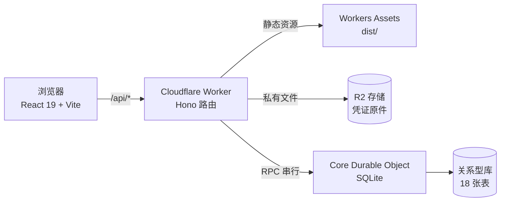

**为什么用 Durable Object 而不是 D1？** Cloudflare 免费计划的 D1 数据库上限是 10 个，该账号已被其他线上项目占满。SQLite 后端的 Durable Object 提供同样的 SQL 语义与事务，天然单写者，正好适合原子化的筹款记账，且完全在免费额度内。数据访问被隔离在 `Db` 接口之后，未来迁移到 D1 / Postgres 是受控的局部改动。

| 层 | 选型 | 理由 |
| --- | --- | --- |
| 界面 | React 19 + TypeScript + Tailwind CSS 4 | 迭代快、无运行时 CSS 开销、设计令牌集中在 `@theme` |
| 动效 | Framer Motion | 拖拽手势、弹簧物理、布局动画 |
| 构建 | Vite 7 | 极快 HMR，路由级代码分割 |
| 接口 | Hono on Cloudflare Workers | 基于 Web 标准 `Request`/`Response` |
| 数据 | Durable Object 内 SQLite | 事务、单写者原子性、无需额外数据库 |
| 文件 | Cloudflare R2 | 私有对象存储 + 对象级元数据 |
| 认证 | 自建会话 | PBKDF2-SHA256 口令散列 + HTTP-only Cookie 令牌 |
| 多语言 | 自建轻量 i18n | 以英文原文为 key，700+ 条词条，无需第三方运行时 |

### 数据模型

主体 18 张表：`users`、`sessions`、`bills`、`receipts`、`swipes`、`payments`、`help_records`、`payment_events`、`notifications`、`reports`、`blocked_users`、`audit_logs`、`community_posts`、`community_likes`、`community_comments`、`bill_updates`，以及 `rate_limits`、`email_outbox` 与 `meta` 键值表。

**金额一律以整数最小货币单位（分）存储**：存储、传输、运算全程没有浮点数。换算边界集中在 `src/shared/money.ts`。

完整 schema 见 [`src/worker/db/schema.ts`](src/worker/db/schema.ts)。

### 支付状态机

```
                 创建支付意图
   (无) ─────────────────────────▶ pending
                                     │
                   结算 ◀────────────┼──────────▶ failed
        （沙箱 / Webhook）           │
                                     ▼
                                 succeeded ──▶ refunded（管理员）
                                     │
                       同一事务内：bills.raised_amount += 金额
                       help_records + 通知 + 社区动态
                       达到目标 → fully_funded（后续支付意图被拒）
```

这些保证都在服务端强制执行，并有测试覆盖：

- **幂等** —— `UNIQUE(payer_id, client_idempotency_key)`，重复请求返回原支付。
- **只结算一次** —— 对已成功的支付再次结算为空操作（`alreadySettled: true`）。
- **原子总额** —— 支付状态、账单累加、帮助记录、通知、社区动态在同一事务内完成；并发下也不会超额筹款（有专门测试）。
- **按剩余额封顶** —— 贡献金额被夹到账单仍缺的部分。
- **渠道隔离** —— 非沙箱渠道的支付会被拒绝以沙箱方式结算。

---

## 安全设计

| 领域 | 实现 |
| --- | --- |
| 口令 | PBKDF2-SHA256（60000 轮）+ 16 字节随机盐 + 恒定时间比较 |
| 会话 | 256 位随机令牌，落库前 SHA-256，约 30 天有效期，HTTP-only + SameSite=Lax + Secure |
| 权限 | 每个管理端路由都在服务端重新校验角色；绝不依赖前端隐藏按钮 |
| 归属校验 | 编辑 / 关闭 / 更新账单在服务层校验 `bill.user_id === 当前用户` |
| 凭证 | 私有 R2 键、魔数校验、原件仅审核员可取、`Cache-Control: private, no-store` |
| 限流 | 基于 Durable Object 的固定窗口，覆盖注册、登录、支付、上传、举报、留言 |
| 输出安全 | React 默认转义、控制字符清理、长度上限，无 `dangerouslySetInnerHTML` |
| 响应头 | 全站 `nosniff`、`X-Frame-Options: DENY`、Referrer-Policy、Permissions-Policy |
| 审计 | 审核、封禁、退款、举报处理全部写入只追加的 `audit_logs` |

发现问题请先读 [`SECURITY.md`](SECURITY.md)，不要直接开公开 issue。

---

## 支付：当前为沙箱，随时可接真实渠道

本次部署运行在 **Payment Sandbox 模式**，并在支付确认页、页脚与 `/payments-info` 页面明确标注：**不会真实扣款，不会真实转账。**

沙箱并非「假装成功」：它走的是与真实渠道完全相同的服务端代码路径。

```
POST /api/payments/intent              → 创建 pending 支付（幂等）
POST /api/payments/:id/sandbox/settle  → 服务端结算，随后更新账单
```

要接真实渠道，改动只发生在服务端：

1. 设置 `PAYMENT_MODE=stripe`，配置 `STRIPE_SECRET_KEY` 与 `STRIPE_WEBHOOK_SECRET`。
2. 实现 `POST /api/webhooks/stripe`：验签后调用同一个 `settlePayment(paymentId, { source: 'webhook' })`。
3. 完成渠道的商户审核与结算主体 KYC。

前端不需要改。上线前请先确认所在地的资金转移合规要求 —— 本项目刻意不让平台自身托管资金。

**没有 Stripe 账号？** 自托管的币安收款网关（例如 [BinancePayTool](https://github.com/qianyubtc/BinancePayTool)）可以接进同一个 provider 接缝；[`docs/deployment.md`](docs/deployment.md) 写清了具体步骤与取舍（个人号风控与条款风险、只读不退款、加密渠道另有合规义务）。**本版本未实现该渠道。**

---

## 本地运行

```bash
git clone https://github.com/iiiiiiiiiiiiiKK/bill-swipe.git
cd bill-swipe
npm install

cp .env.example .dev.vars   # 可选，默认即为沙箱配置
npm run dev:api             # 终端 1：API 在 http://127.0.0.1:8787
npm run dev                 # 终端 2：界面在 http://127.0.0.1:5173
```

打开 <http://127.0.0.1:5173>。首次启动会自动写入演示数据（16 张虚构账单、15 位用户、帮助记录），全部带 `is_demo` 标记并在界面显示「演示」。

**演示账号**（已预置，界面明确标注）：

| 角色 | 邮箱 | 密码 |
| --- | --- | --- |
| 管理员 | `admin@billswipe.local` | `BillSwipe!Admin2026` |
| 普通用户 | 自行注册（5 秒） | — |

> 正式使用前请更换：`ADMIN_EMAIL` / `ADMIN_PASSWORD` 用于初始化管理员；`ALLOW_DEMO_SEED=false` 可整体关闭演示数据。

> **Windows 提示**：部分机器上 `wrangler dev` 会因缺少 VC++ 运行库导致 `workerd` 栈溢出崩溃。此时可以改为对已部署实例跑测试：`E2E_BASE_URL=https://你的域名 npm run test:e2e`。

---

## 测试

```bash
npm run typecheck                                # 严格 TypeScript，零错误
npm test                                         # 46 个单元/集成测试（真实 SQLite + 字典校验）
npm run test:e2e                                 # 29 条端到端流程（桌面 Chrome + iPhone/WebKit）
node scripts/smoke.mjs https://你的域名            # 31 项 API 契约检查
node scripts/audit-ui.mjs https://你的域名 en      # 337 项响应式/无障碍检查（英文）
node scripts/audit-ui.mjs https://你的域名 zh      # 同上，中文界面
node scripts/audit-i18n.mjs https://你的域名       # 翻译覆盖率，当前 0 处未翻译
```

测试实际证明的内容：

- **金额正确性** —— 零浮点漂移、手续费取整、按剩余额封顶、幂等与重放安全、退款回滚，以及**并发下绝不超额筹款**。
- **权限边界** —— 普通用户访问管理端返回 403；改不了也关不了别人的账单；匿名帮助人对公众隐藏、对账单主人可见。
- **界面诚实** —— 沙箱提示出现在确认环节；只有服务端返回成功，界面才会显示成功。
- **响应式质量** —— 320 → 1920px 八种视口下零横向溢出、触控目标 ≥32px、正文无小于 10px 的字号、颜色对比度满足 WCAG AA（中英双语各跑一遍）。
- **真实流程** —— 注册 → 滑动 → 选金额 → 确认 → 成功；五步发布向导；后台审核队列；以及**整站切中文再切回英文**。
- **翻译完整性** —— 13 条路由在中文状态下逐条爬取 DOM，任何残留英文都会报错，当前为 **0**。

实测结果记录见 [`docs/testing.md`](docs/testing.md)。

---

## 部署自己的实例

完整步骤（Cloudflare 账号、R2 存储桶、自定义域名、密钥管理）见 [`docs/deployment.md`](docs/deployment.md)。简版：

```bash
npm install
npx wrangler login
npx wrangler r2 bucket create billswipe-receipts

npx wrangler secret put SESSION_SECRET
npx wrangler secret put ADMIN_PASSWORD

npm run deploy        # 构建前端 + wrangler deploy
```

`wrangler.toml` 已声明 Worker、静态资源绑定、Durable Object migration、R2 绑定与自定义域名路由。数据库就在 Durable Object 内，**没有单独的迁移步骤** —— 首次请求时自动建表并写入种子数据。

若之后删除并重建 Worker，域名绑定会丢失，用 `node scripts/attach-domain.mjs 你的域名 billswipe` 重新挂载。

---

## 项目结构

```
src/
  shared/            领域类型、金额工具、账单分类（前后端共用）
  worker/
    index.ts         Worker 入口：/api/* 走 Hono，其余走静态资源
    api.ts           HTTP 层：路由、Zod 校验、Cookie、错误映射
    core/
      index.ts       Core Durable Object：RPC 分发 + 串行业务写入
      service.ts     领域服务（账号、账单、支付、审核）
      queries.ts     读模型 / DTO 组装
    db/              建表语句 + 类型化查询层
    auth/            PBKDF2 散列、令牌、ID
    seed/            带标记的演示数据
  components/        设计系统原子组件、账单卡片、支付面板、后台组件
  pages/             首页、发现、账单详情、发布向导、动态、个人中心、后台…
  lib/               API 客户端、登录态、i18n 字典与切换器、标签本地化
tests/               单元 + 集成（vitest）与端到端流程（playwright）
scripts/             契约测试、UI 审计、翻译审计、截图采集、域名挂载
docs/                架构、部署、测试报告、截图
```

---

## 已知限制（如实披露）

1. **支付为沙箱**：接入真实渠道、Webhook 验签与结算资质尚未完成，界面已在所有关键位置标注。
2. **邮件只入队未投递**：未配置 `RESEND_API_KEY` 时，验证与通知邮件写入 `email_outbox` 表而不发送。
3. **邮箱验证未强制**：流程已实现，但演示阶段未开启强制拦截。
4. **单一 Durable Object**：所有写入串行化，正确性极佳，但存在吞吐上限；真实放量前需分片或迁移到 D1/Postgres。
5. **无 KYC**：没有任何机制验证发布者身份，审核仅为人工核对单据。
6. **凭证脱敏靠人工**：界面会提示用户自行遮挡敏感信息，不做自动 PII 识别。
7. **只有中英两种语言**：字典以英文原文为 key（`src/lib/i18n.tsx`，700+ 条），新增语言需要扩充字典；服务端生成的通知文案以英文入库，渲染时本地化。
8. **演示数据**：`is_demo = 1` 且界面带「演示」标记，影响力统计包含它们并在界面说明。

---

## 路线图

- [ ] 接入 Stripe Connect（或本地合规渠道），含 Webhook 验签与分账
- [ ] 凭证上传的自动 PII 识别与打码
- [ ] 邮件服务商接入（验证、摘要）
- [ ] 推送通知与完整 PWA 安装流程
- [ ] 多币种与汇率换算展示
- [ ] 数据层分片或迁移，以支撑更高写入吞吐
- [ ] 英文之外更多语言包

---

## 参与贡献

欢迎 issue 与 pull request，请先看 [`CONTRIBUTING.md`](CONTRIBUTING.md)。涉及安全的内容请按 `SECURITY.md` 私下联系。两条底线：不编造数据、不伪造成功状态。

## 许可证

[MIT](LICENSE) © BILL SWIPE contributors

---

<div align="center">

**一张账单，一份善意。**

由 [@0xkillcoin](https://x.com/0xkillcoin) 构建与维护 · [𝕏](https://x.com/0xkillcoin)

</div>
